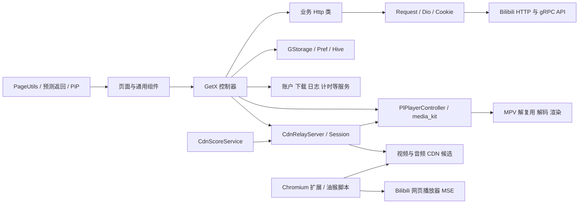

# PiliPlus Adaptive CDN 完整项目框架

> 本文是后续修改本项目时的稳定架构基准。它说明“系统由什么组成、数据怎样流动、关键类负责什么、修改某类需求应落在哪里”。精确到每个项目文件和每个可识别类/函数的清单分别见 [SOURCE_FILE_INDEX.md](SOURCE_FILE_INDEX.md) 与 [SYMBOL_INDEX.md](SYMBOL_INDEX.md)。

## 1. 文档使用规则

每次开始代码任务时按以下顺序核对：

1. 根目录 `AGENTS.md`：工作边界、禁止事项与交付规则。
2. `docs/PROJECT_CONTEXT.md`：当前产品行为、最近决定、已接受基线与构建方式。
3. 本文：稳定架构、模块职责、关键流程与修改入口。
4. `docs/SOURCE_FILE_INDEX.md`：全量文件定位。
5. `docs/SYMBOL_INDEX.md`：类、函数和方法定位。
6. 最后以当前源代码和测试为准；若代码结构已经变化，应在同一任务中更新本文并重新生成两个索引。

本文不复制所有函数实现。全量符号索引负责“一个都不漏地定位”，本文负责解释其上下文和边界。自动生成文件只索引顶层类型，避免把生成器样板误当成手写业务逻辑。

## 2. 项目身份与范围

- 当前仓库：`amountnothing/PiliPlus-Adaptive-CDN`，默认分支 `main`。
- 原项目/上游：`bggRGjQaUbCoE/PiliPlus`。
- 产品本体：Flutter 编写的第三方 Bilibili 客户端，覆盖 Android、iOS、macOS、Windows、Linux。
- 本仓库扩展：自适应 CDN、本地 Range Relay、播放冻结保护、跨重建进度恢复、CDN 评分，以及 Chromium 扩展和油猴脚本。
- Flutter/Dart：项目通过 `.fvmrc` 固定 Flutter；Dart SDK 约束和依赖以 `pubspec.yaml` 为准。
- 播放内核：`media_kit`/MPV；后台媒体会话使用 `audio_service`。
- 状态与路由：GetX。
- HTTP：Dio 加项目自有 `Request` 封装。
- 本地存储：Hive CE，加偏好设置封装。

当前仓库约有 1673 个受版本控制文件，主体是 `lib/` 下的 Dart 代码；`models_new/`、`grpc/` 和序列化生成文件占较大比例。完整数量以重新生成的文件索引为准。

## 3. 总体架构



边界原则：

- 页面只负责布局、用户交互和把事件交给控制器。
- 控制器组织业务状态、生命周期和跨模块流程。
- `http/` 只负责请求协议和响应解析，不承载页面布局。
- `services/` 管理跨页面、长生命周期或系统级资源。
- `plugin/pl_player/` 管理通用播放器，不应塞入只属于视频详情页的业务。
- 自适应 CDN 的网络字节切换位于 Relay；触发判断和播放器恢复位于视频控制器；候选生成位于 `VideoUtils`；历史质量位于 `CdnScoreService`。
- 浏览器扩展是独立实现，不直接复用 Flutter/MPV 代码，但产品规则应尽量一致。

## 4. 根目录与目录职责

| 路径 | 作用 | 修改注意事项 |
|---|---|---|
| `lib/` | Flutter 主程序 | 主业务代码 |
| `lib/main.dart` | 进程入口、全局初始化、根应用 | 改动影响所有平台和启动阶段 |
| `lib/pages/` | 按业务域组织页面、控制器和局部组件 | 首选在所属业务目录修改 |
| `lib/common/` | 常量、样式、通用组件、骨架屏、Flutter 补丁 | 必须确认多个调用方都需要该变化 |
| `lib/http/` | 请求核心及各业务 API 封装 | 保持协议处理与 UI 分离 |
| `lib/models/` | 旧版/基础领域模型 | 不要无理由与 `models_new` 互迁 |
| `lib/models_new/` | 新版 API 模型与序列化生成物 | `.g.dart`、`.freezed.dart` 通常不手改 |
| `lib/grpc/` | Bilibili protobuf/gRPC 契约及生成代码 | 由协议生成，通常不手改 |
| `lib/plugin/pl_player/` | 通用播放器控制器、数据源、状态和 UI | 保留手动暂停、后台播放、PiP 语义 |
| `lib/services/` | 跨页服务：账户、下载、日志、CDN Relay/评分等 | 明确所有权、启动和释放时机 |
| `lib/utils/` | 无状态或轻状态工具、偏好、导航、视频 URL 等 | 避免变成新的全局业务控制器 |
| `lib/router/` | GetX 路由表 | 新页面需同时核对参数和返回行为 |
| `lib/scripts/` | 弹幕/播放器相关脚本资源 | 与 WebView/播放器调用约定保持同步 |
| `android/` 等平台目录 | 原生入口、插件注册、权限、打包 | 平台专属能力留在所属目录 |
| `browser-extension/` | Chromium Manifest V3 扩展源代码与测试 | 与 App 对齐规则，不共享运行时 |
| `dist/` | 可直接分发的油猴脚本等产物 | 由源文件生成，修改源后同步生成 |
| `test/` | Dart 单元/组件测试 | 播放与 CDN 修复优先加定向回归测试 |
| `.github/workflows/` | 多平台构建、上游同步、Release | 本地成功不等于云端成功 |
| `assets/` | 图片、字体、着色器、证书/资源 | 由 `pubspec.yaml` 声明后才能打包 |
| `patches/` | 依赖或平台补丁 | 合并上游时重点核对 |
| `tool/` | 本项目维护工具 | `generate_codebase_index.ps1` 生成本文配套索引 |

## 5. 启动与全局生命周期

### 5.1 `lib/main.dart`

- `main()`：绑定 Flutter，引导 MediaKit、路径、Hive/偏好、网络、Cookie、服务定位、主题、系统 UI、桌面窗口及 Catcher2，最后挂载根应用。
- `_initDownPath()`、`_initTmpPath()`、`_initAppPath()`：确定下载、临时和应用数据目录。
- `MyApp`：构建 `GetMaterialApp`，连接主题、语言、路由、全局导航和异常展示。
- `_PredictiveBackGestureDispatcher`：把系统预测返回手势送入 Flutter 路由体系。
- `_CustomHttpOverrides`：设置项目需要的全局 HTTP 行为。

启动顺序不可随意倒置：路径必须先于存储，存储先于依赖它的偏好和账户，播放器内核先于创建播放器，窗口/系统 UI 只在对应平台执行。

### 5.2 服务定位与全局对象

- `lib/services/service_locator.dart`：集中注册和取得共享服务。
- `lib/services/account_service.dart`：当前账户、多账户及账户变化通知。
- `lib/services/logger_service.dart`：应用日志写入、读取和清理；诊断日志必须节流且只记录状态边沿。
- `lib/services/timer_service.dart`：共享定时任务。

全局服务只保存真正跨页面的状态。页面临时状态仍放在所属 GetX 控制器，页面销毁时释放。

## 6. 路由、页面与 UI

### 6.1 路由

- `lib/router/app_pages.dart` 的 `Routes` 定义路径常量和 `GetPage` 表。
- 路由页通常由 `view.dart`、`controller.dart` 和局部 `widgets/` 组成。
- 页面参数通过 GetX arguments/parameters 传入；返回值通过路由结果传出。

### 6.2 页面模块分组

`lib/pages/` 的主要业务域如下。完整子目录和文件见文件索引。

- 主框架与发现：`main`、`home`、`popular`、`rank`、`search`、`search_panel`、`recommend`。
- 视频链路：`video`、`video_page`、`video_edit`、`video_download`、`video_intro`、`video_reply`、`video_member`、`video_tag`、`video_note`、`video_ai`。
- 直播与音频：`live`、`live_room`、`live_area`、`audio`、`music`。
- 动态与内容：`dynamics`、`dynamic_detail`、`article`、`opus`、`topic_detail`、`whisper`。
- 评论与消息：`reply`、`reply_detail`、`message`、`messages`、`chat`、`at_me`、`like_me`。
- 用户与关系：`member`、`member_dynamics`、`member_search`、`follow`、`fans`、`login`、`account`。
- 收藏与历史：`fav`、`fav_detail`、`later`、`history`、`watch_later`、`subscription`、`followed_series`。
- 离线与文件：`download`、`download_manage`、`offline`、`file_manager`。
- 设置与工具：`setting`、`about`、`logs`、`webview`、`qr_code`、`sponsor_block`。

### 6.3 通用 UI

- `lib/common/widgets/`：跨业务复用的卡片、图片、加载态、对话框、弹层、导航和交互组件。
- `lib/common/skeleton/`：首屏和列表骨架。
- `lib/common/constants.dart`、`assets.dart`、`theme.dart` 等：颜色、尺寸、资源和主题约定。
- `lib/utils/page_utils.dart`：集中页面跳转、Hero/预测返回目标、PiP 与常用页面动作。

预测返回/Hero 的对象必须是真正的封面渲染区域，不能用整行卡片容器冒充封面矩形。普通页面返回使用标准预测返回；视频封面变换只有在来源和目标均可可靠定位时才启用。

## 7. 网络、认证与数据模型

### 7.1 `Request` 与 Dio

- `lib/http/init.dart` 的 `Request` 负责 Dio 实例、基础头、Cookie、代理/证书、响应解码、网络适配器重置和下载。
- `lib/http/retry_interceptor.dart` 只处理适合重试的请求错误；非幂等写操作不能盲目自动重试。
- `lib/http/api.dart` 聚合接口入口。
- 业务 `*Http` 类把 URL、参数、认证方式和响应模型封装在对应域内，如视频、动态、评论、账户、直播、搜索等。

常规请求流：页面事件 → 控制器 → 业务 Http 静态方法 → `Request`/Dio → Cookie/签名/网络 → 模型解析 → `LoadingState` → UI。

### 7.2 认证与账户

- Cookie、CSRF、WBI 等认证信息通过网络和账户服务统一提供。
- `AccountService` 管理当前账户；切换账户后依赖账户的数据源必须刷新，不能沿用旧账户缓存。
- `RequestUtils` 提供历史同步、分享、收藏、关系、评论和动态等跨页面常用请求动作。

### 7.3 模型

- `lib/models/`：既有领域对象和部分手写解析。
- `lib/models_new/`：重构后的 DTO、Freezed/JSON 生成模型。
- `lib/grpc/`：protobuf 生成类、枚举、JSON 描述和服务定义。
- `LoadingState<T>` 统一表达加载、成功、失败等 UI 数据状态。

生成文件标识包括 `.g.dart`、`.freezed.dart`、`.pb.dart`、`.pbenum.dart`、`.pbjson.dart`、`.pbserver.dart`。修改定义后应运行对应生成器，而不是直接编辑生成结果。

## 8. 存储、偏好与缓存

- `lib/utils/storage.dart` 的 `GStorage` 初始化 Hive box，负责导入/导出、适配器、压缩、清理和关闭。
- `lib/utils/storage_pref.dart` 的 `Pref` 提供类型化偏好；播放器缓冲、直播缓冲、解码、画面比例等设置由这里读取。
- 图片/网络缓存使用项目缓存管理器；临时文件放应用临时目录。
- 下载数据由 `DownloadService` 和下载模型维护，不能与播放临时缓存混为一谈。

新增持久字段时必须定义默认值、升级兼容和清理策略。临时播放检查点只用于异常重建恢复，不应改变云端观看历史语义。

## 9. 播放器框架

### 9.1 通用播放器层

`lib/plugin/pl_player/` 是通用播放模块：

- `PlPlayerController`：创建/释放 `Player`，设置音视频数据源，监听 position/buffer/completed/error，处理播放暂停、seek、倍速、画面适配、手势、全屏、PiP、生命周期、后台音频会话和心跳。
- `DataSource` 及相关 source 模型：承载视频 URL、音频 URL、请求头、字幕、封面和媒体元数据。
- `PLVideoPlayer` 及 widgets：播放器画面、控制层、进度、手势和状态展示。
- status/model 文件：播放器 UI 状态、手势状态、字幕/弹幕/清晰度等结构。

通用层必须区分三种暂停来源：

1. 用户明确暂停：保持暂停，任何自动恢复都不能覆盖。
2. 系统/生命周期临时暂停：仅在原本应播放且条件恢复时自动继续。
3. 播放保护暂停：音频或视频任一轨卡住时整体进入缓冲态，恢复后自动继续。

进度显示来自实际播放时钟；保护暂停期间音频、视频和进度必须一起停止。

网络点播每次接受播放请求后还会短时观察真实播放时钟，而不只相信底层乐观的 `playing` 事件。已有至少 500ms 前向缓存但时钟仍不前进时，先通过一次原生 pause/play 边沿唤醒且保留 MPV 缓存；继续停滞才按同一媒体检查点重开数据源。无可用缓存时不走该路径，交给网络/CDN 恢复，避免弱网反复清空缓存。

### 9.2 视频详情业务层

- `lib/pages/video/controller.dart` 的 `VideoDetailController` 是点播播放主编排器。
- `lib/pages/video/view.dart` 的 `VideoDetailPageV` 负责页面生命周期、播放器回调、竖横屏布局、简介/评论区域和返回动画。
- 视频控制器负责：获取 playurl、选清晰度/编码、构造候选、建立 Relay、播放器初始化、播放健康监控、CDN 切换、PTS/码流错误恢复、检查点和观看历史。
- 播放器通用控制器负责：真正的媒体命令和 UI 状态，不负责 Bilibili playurl 业务。多个视频详情页复用播放器时以媒体打开代次确定唯一所有者；旧媒体替换过程中迟到的流事件不能修改新媒体的播放意图、进度或错误恢复状态。

### 9.3 后台播放与系统媒体会话

- `lib/services/audio_service.dart` 的 `VideoPlayerServiceHandler` 把播放/暂停/seek/元数据映射到系统媒体会话。
- Android 原生 `MediaHelper`/`AndroidHelper` 处理媒体按键、通知/PiP 等平台动作。
- 切到后台、锁屏、基站/网络变化不能被误当成用户暂停；系统回调也不能反向覆盖明确暂停。
- 生命周期临时暂停恢复必须核对进入后台时的手动暂停代次；回到前台后同一媒体 5 秒仍无有效进度时，允许保留检查点重开同一数据源，不能直接用底层 `play()` 覆盖后台期间的用户暂停。
- 禁止后台播放时，以 `playbackRequested` 记录是否需要前台恢复，不能依赖进入后台瞬间可能因 buffering 已变为 false 的底层 `playing`。自适应网络源由统一播放看门狗恢复；其他源继续使用生命周期 5 秒检查，二者不能并发重开。

### 9.4 原生 PiP

- Android `AndroidHelper.enterPip`、`updatePipActions`、`disableAutoEnterPip` 与 `MainActivity` 生命周期共同管理系统画中画。
- `PageUtils` 和播放器控制器发起 PiP；打开新视频/直播时旧播放实例应按产品规则关闭。
- PiP 是系统窗口，不应依赖应用内 Overlay 模拟。

## 10. 自适应 CDN 完整链路

### 10.1 职责分层

| 层 | 主要文件/类型 | 职责 |
|---|---|---|
| 候选 | `VideoUtils` | 从 playurl 提取/规范化 CDN 候选，识别 host、冷却失败节点 |
| 评分 | `CdnScoreService` | 记录成功、失败、吞吐/稳定性并排序候选 |
| 触发 | `VideoDetailController` | 观察缓冲净增长、音视频 PTS、播放器错误和网络状态 |
| 字节 Relay | `CdnRelayServer`、`CdnRelaySession` | 对播放器提供稳定的本地 URL，向远端发 Range 请求并在失败时换源 |
| 播放恢复 | `VideoDetailController`、`PlPlayerController` | 保护暂停、保留检查点、必要时重建并 seek 回去 |
| 日志 | `_logAdaptive`、`LoggerService` | 仅在日志模式记录关键状态边沿和一次性原因 |

### 10.2 正常建立播放

1. `VideoDetailController` 请求 DASH playurl，分别取得视频轨和音频轨。
2. `VideoUtils.getCdnCandidates()` 生成候选并过滤冷却节点。
3. `CdnScoreService` 按当前历史稳定性排序。
4. `CdnRelayServer` 在 `127.0.0.1` 启动共享服务器并创建会话。
5. 会话为 video/audio 暴露稳定的本地 Relay URL。
6. `DataSource` 把本地 URL 交给 MPV；MPV 仍分别读取音视频轨。
7. Relay 把 MPV 的 Range 请求转发到当前远端 CDN。

### 10.3 切换细节

Relay 不是把两个完整文件简单拼成新媒体。播放器看到的是同一资源的连续字节地址空间：

```text
播放器请求:  bytes=N------------------------------M
旧 CDN A:    [N...........K] 连接失败
已确认边界:               K+1
新 CDN B:                  [K+1............M]
Relay 输出:  [N...........K][K+1............M]
```

关键约束：

- 只在已确认成功写给播放器的字节之后续传。
- 新 CDN 必须请求同一资源、同一轨、同一编码和同一字节区间。
- 响应的长度、Content-Range、总资源大小和身份必须一致。
- 不把同一响应中未经验证的重叠字节重复输出，也不留下缺口。
- 音轨和视频轨独立 Range、独立候选失败集合和独立切换额度，但共享“整体卡住”的播放保护语义；任一轨的切换不能消耗另一轨的恢复机会。
- Relay URL 不变，因此一次正常 CDN 切换不应让前台播放器重建或清空已有缓冲。

为避免 AV1 `Invalid OBU` / `Failed to parse temporal unit`，切换点必须是精确字节边界。若上游响应无法证明可安全续传，Relay 返回“需要重建”，由播放器在时间轴层恢复，不能冒险把不连续片段送入同一解码流。

### 10.4 切换触发

当前主要触发类别：

- 上游 HTTP 错误、连接/Socket 错误或上游 IO 连续静默 5 秒；暂停停表，恢复重计时，下游 flush 背压不计入。
- 当前 CDN 开始回填后，在观察窗口内缓冲净增长不足。
- 播放器报告可确认的本地 Relay 打开错误。
- 可恢复的码流/解码错误，先淘汰可疑 CDN，必要时重建。
- 音频或视频 PTS 任一冻结，整体进入保护并参与 CDN 检测。

切换前的公网连通性保护会探测两个公共 DNS 端点；若都不可达，优先认为是整体网络中断，继续给当前 CDN 恢复时间，避免在断网时耗尽全部候选。该探测不是周期性流量源，只在准备换 CDN 的异常路径执行。

### 10.5 缓冲与冻结

- 自适应 MPV 全程采用 4 秒、1–4 MiB 前向预取上限，2 秒 hysteresis；旧 30 秒目标持久值保留兼容，不再控制实际前向队列。
- MPV 使用 `cache-pause-initial=no`，断流恢复 `cache-pause-wait=0.250`。预取上限不是首帧门槛，也不证明真机出帧已加快；仍受探测、关键帧、解码初始化影响。
- 回填观察线与 PTS 冻结最低缓冲有效上限均为 2 秒，避免 4 秒满队列永远落在旧 20 秒回填线以下或永远达不到旧 10 秒冻结门槛。回填观察约 5 秒、净增长不足约 1 秒时才候选换源；若播放推进至少 1 秒且缓存净变化不低于 -250ms，则属于持续补足的字节受限小队列，不按缓存平坦判 CDN 失败。
- PTS 是媒体帧的播放时间戳。视频 PTS 不动而音频/position 前进，表现为“画面卡住声音继续”；音频 PTS 不动也视为整体卡住。前向缓冲不足时通常不单凭单轨 PTS 判冻结，但若另一轨 PTS 明确继续前进，则已经证明音画分离，仍应整体恢复。切网后某条预期轨道的 PTS 从有效值变为 `null` 时，不能把 `null` 当成新基线反复清零计时；另一轨继续前进达到冻结窗口后必须整体恢复。启播阶段从未产生过有效 PTS 的轨道仍处于初始化，不得仅因另一轨先开始前进而判定冻结。
- 用户暂停、seek、切集、页面销毁、后台策略暂停和播放结束都必须先排除，不能被判成 PTS 冻结。
- 片尾判断的默认上限仍是最后 5 秒，但短视频使用不超过总时长约 10% 的窗口，避免启动位置被误当成片尾；切换到新 CID 时不能继承上一媒体播放完成产生的暂停意图。

### 10.6 必要重建与进度保留

只有以下情况允许重建播放器/Relay：

- Relay 无法安全维持连续字节流。
- MPV 已收到损坏码流并污染解码器状态。
- 本地 Relay 会话已经失效，稳定 URL 无法重新打开。
- PTS 长时间冻结且普通换 CDN 无法恢复。

重建过程：

1. 记录当前 `cid`、播放位置、是否本应播放，以及短期本地检查点。
2. 进入保护缓冲态，停止音频、视频和进度共同前进。
3. 退役旧 Relay，创建新会话和干净数据源。
4. 新播放器 ready 后 seek 到同一 `cid` 的可靠检查点。
5. 只有重建前是自动播放且用户未在期间明确暂停时才继续播放。
6. 成功后清理过期检查点；观看历史仍按原有云端策略同步。

禁止在位置还未初始化为可靠值时用 `0` 覆盖已有非零检查点。通过云端历史或页面参数传入的非零起播位置，在 MPV 时钟到达该位置附近前也是待确认检查点；启动期间先上报的 0/早期位置不能覆盖它，CDN 重建必须继续使用该位置。用户明确 seek 后取消待确认状态，以保证主动回到开头或其他位置仍然生效。重复错误还应有互斥、冷却和同一事件去重，防止重建风暴。

### 10.7 生命周期与流量

- 页面关闭、切换媒体、播放完成、停止下载或废弃会话时必须关闭远端请求并退役 Relay。
- 旧页面堆叠时不可误杀仍被上层页面使用的当前播放源，但最终所有者销毁时必须释放。
- 播放完成后不再回填目标缓冲，也不再做 CDN 探测。
- 后台播放继续时只保留必要音视频请求；明确暂停时不可由网络恢复逻辑自动启动。
- 明确暂停/禁止后台播放时，活动 Relay Range 响应优先靠背压原地保留，只暂存至多一个在途 chunk；恢复后继续同一响应和字节位置。仅当连接自身已经失效才允许播放器重新发 Range，且该暂停侧失效不扣 CDN 分或触发换源。下游断开会唤醒暂停等待并取消上游；socket 输入独立观察 FIN，请求字节队列上限 64 KiB，每个 HTTP 请求结束移除断开订阅，避免 keepalive 残留请求状态。

## 11. 浏览器扩展与油猴脚本

### 11.1 文件组成

- `browser-extension/manifest.json`：Manifest V3 权限、脚本和入口。
- `browser-extension/bridge.js`：扩展环境与页面脚本之间传递配置/消息。
- `browser-extension/core.js`：纯逻辑核心，包括设置规范化、URL/资源键、CDN 评分/冷却和切换决策；由 Node 测试覆盖。
- `browser-extension/page.js`：注入页面，拦截 playurl/fetch/XHR，识别实际 DASH 候选，协调 MSE/Range 请求和播放器缓冲态。
- `options.*`、`popup.*`：用户界面。
- `browser-extension/test/core.test.cjs`：核心决策回归测试。
- `browser-extension/test/page.test.cjs`、`xhr.test.cjs`：传输重试、退休取消、播放位置/暂停和 fatal 边界回归。
- `browser-extension/test/chromium.cjs`：Playwright 原生 Chromium fetch/XHR 传输与原生 MediaError 夹具；不证明 fatal MSE 自动恢复。
- `dist/PiliPlus-Adaptive-CDN-Web.user.js`：油猴分发产物。

### 11.2 与 App 的相同点和不同点

相同：

- 从当前视频真实返回中取得候选。
- 依据失败、冷却、缓冲净增长和整体网络状态换 CDN。
- 画面或音频任一停滞时统一进入缓冲语义。
- 用户明确暂停不触发冻结检测，也不会自动续播。

不同：

- App 以本地 HTTP Range Relay 给 MPV 提供稳定 URL。
- 浏览器端控制网页播放器的 fetch/XHR/MSE，必须保留已有 SourceBuffer，不能通过替换 `<video>` 或清空 MSE 来换 CDN。
- 网页端不能使用 App 的固定 CDN 名单，只能使用该 playurl 返回且资源身份一致的候选。
- “卡住保护”应表现为等待/缓冲并在恢复后自动继续，不应调用会改变用户意图的永久 `video.pause()`。

0.2.18 由 `recoverCandidate` 按资源/代次合并 fetch、XHR、多 Range、fatal 与健康检测的自动切换。候选默认观察 15 秒；HTTP 确定失败也等待剩余窗口，网络保护每代仅采样一次并最多追加一次有界等待。资源独立失败集合/冷却快照，旧代次不处罚新候选；playurl 重注册不能用全局冷却旁路改选。暂停、取消、禁用和会话退休立即释放等待，最后一个请求取消后不保留后台切换（独立健康/fatal 请求除外）。在失败终态暴露前重试同一 GET/Range，候选只来自 API 四 URL 字段；不拼接已交付响应体。主动换源中止当前尝试并重试，resetVideoSession 则取消整个请求所有权和待执行重试。fatal MediaError 每源仅准备一次下一候选并重试在途请求；无已验证播放器重载接口时提示网页/手动重载，禁止把 URL 变更称为 MSE 已恢复，也不自动 play/seek。

0.2.20 启动快速失败：候选从未交付任何字节时观察窗缩短为 5 秒首字节预算（交付过字节仍 15 秒），确定失败仍等 `failCooldownMs`。因 B 站播放器会在终态前自行 abort 媒体请求轮换 host，另加每资源看门狗（`armCandidateWatchdog`，1 秒 tick）：未收字节、候选起始超过 5 秒且该资源仍有活跃请求时，以同一 `recoverCandidate` 事务后台切换；播放器已放弃且无在途请求的资源不切换。

切屏/标签页隐藏只能调整检测定时精度，不能直接把可播放状态改为用户暂停。

## 12. 下载、离线与其他跨页服务

- `DownloadService`：加载任务、创建下载、分轨下载视频/音频、封面、弹幕，完成合并/登记，取消和删除。
- 下载管理页面展示任务并调用服务，不直接持有底层网络资源。
- 离线播放使用本地 `DataSource`，不进入在线 CDN Relay。
- 投屏、WebDAV、分享、通知等功能各自通过工具/服务与页面协调，完整入口可在符号索引按类名检索。

## 13. 平台层

### Android

- `MainActivity.kt`：Activity 生命周期、配置变化、PiP 变化、离开提示、音频服务结束。
- `AndroidHelper.java`：系统返回、反诈/链接设置、PiP 参数和动作、快捷方式等桥接。
- `MediaHelper.java`：系统媒体动作/按键映射。
- `AndroidManifest.xml`：权限、Activity、Service、PiP 和 intent-filter。

### iOS/macOS

- `AppDelegate.swift`：Flutter 引擎与平台初始化。
- macOS `MainFlutterWindow.swift`：桌面窗口装配。
- `Runner/GeneratedPluginRegistrant.*`：自动生成插件注册，不手改。

### Windows/Linux

- runner 的 C++/C 文件负责窗口、消息循环、Flutter 引擎和插件装配。
- 平台构建文件控制打包；业务行为尽量留在 Dart，原生代码只承载平台能力。

## 14. 关键类与函数导航

下表列出需要理解上下文的核心入口；其余所有类/函数见符号索引。

| 符号 | 文件 | 作用 |
|---|---|---|
| `main`, `MyApp` | `lib/main.dart` | 应用启动、全局初始化、根 Widget |
| `Routes` | `lib/router/app_pages.dart` | 全部命名路由和页面绑定 |
| `Request` | `lib/http/init.dart` | Dio、Cookie、网络适配器、下载和解码 |
| 各 `*Http` | `lib/http/` | 对应业务域 API |
| `GStorage` | `lib/utils/storage.dart` | Hive 生命周期、导入导出和清理 |
| `Pref` | `lib/utils/storage_pref.dart` | 类型化偏好与播放配置 |
| `AccountService` | `lib/services/account_service.dart` | 多账户与当前账户状态 |
| `MainController`, `MainApp` | `lib/pages/main/` | 顶层标签、未读、账户、窗口/主框架 |
| `VideoDetailController` | `lib/pages/video/controller.dart` | 点播业务、Relay、健康检测和恢复编排 |
| `VideoDetailPageV` | `lib/pages/video/view.dart` | 视频页布局、生命周期、返回和面板 |
| `PlPlayerController` | `lib/plugin/pl_player/controller.dart` | 通用播放器命令、状态、后台、PiP、手势 |
| `PLVideoPlayer` | `lib/plugin/pl_player/pl_player.dart` 等 | 播放画面和控制层 |
| `DataSource` | `lib/plugin/pl_player/models/` | 音视频输入及媒体元数据 |
| `CdnRelayServer` | `lib/services/cdn_relay_server.dart` | 共享本地服务器、会话注册、连通性探测 |
| `CdnRelaySession` | 同上 | 单媒体会话、音视频 Range 转发和换源 |
| `_RelayTrackState` | 同上 | 单轨 CDN、偏移、响应和失败状态 |
| `_NetworkImpairmentGuard` | 同上 | 网络中断时延迟切换、防候选风暴 |
| `CdnScoreService` | `lib/services/cdn_score_service.dart` | CDN 历史评分、排序、冷却和持久化 |
| `VideoUtils` | `lib/utils/video_utils.dart` | playurl/CDN 候选、host、直播 URL 等 |
| `PageUtils` | `lib/utils/page_utils.dart` | 导航、Hero/预测返回、PiP、页面动作 |
| `AdaptivePlayback` | `lib/utils/adaptive_playback.dart` | 自适应播放共用判定/状态工具 |
| `VideoPlayerServiceHandler` | `lib/services/audio_service.dart` | 系统媒体会话与播放器控制映射 |
| `DownloadService` | `lib/services/download_service.dart` | 下载任务与文件生命周期 |
| `RequestUtils` | `lib/utils/request_utils.dart` | 跨页面常用写操作与同步动作 |
| `LoggerService` | `lib/services/logger_service.dart` | 诊断日志持久化与查看 |

符号索引的每一项包含文件和行号。行号随代码变化会漂移，修改后必须重生成。

## 15. 常见需求应修改哪里

| 需求 | 首查位置 | 避免误改 |
|---|---|---|
| 页面布局/卡片比例 | 对应 `lib/pages/<domain>/view.dart` 与 widgets | 播放器网络逻辑 |
| 页面状态/加载请求 | 对应 controller + `*Http` | 全局 `Request`，除非所有请求都应变 |
| 预测返回/封面位置 | 来源卡片、目标页、`PageUtils` | CDN/播放器画面尺寸 |
| 播放控制 UI | `plugin/pl_player/widgets` | 视频 playurl/Relay |
| 手动暂停/后台续播 | `PlPlayerController`、audio service、生命周期 | CDN 字节拼接 |
| 画面卡音频走 | 视频健康检测、PTS、保护缓冲 | UI 尺寸和 Hero |
| CDN 候选错误 | `VideoUtils`、playurl 解析 | MPV 控制层 |
| CDN 切换破坏码流 | `CdnRelaySession` Range/边界 | 页面 Widget |
| 重建丢进度 | 视频控制器检查点与 ready 后 seek | 云端历史逻辑 |
| 播放结束耗流量 | controller dispose/completed、Relay retire | 下载服务 |
| 图片连接关闭日志 | 图片缓存/HTTP 错误降噪与重试 | 视频 Relay |
| 浏览器切换黑屏 | `browser-extension/page.js` 的 MSE/请求切换 | Flutter 代码 |
| 设置项 | 设置页 + `Pref` + 默认值/迁移 | 临时控制器字段 |
| 新 API | 对应 `*Http` + model + controller | 在 Widget 直接写 Dio |
| Android PiP | `PageUtils`、播放器、AndroidHelper/MainActivity | 应用内 Overlay 替代系统 PiP |
| Release/云端构建 | `.github/workflows`、Gradle、pubspec | 以本地 APK 存在代替云端核验 |

## 16. 项目不变量与禁止事项

以下是后续修改必须保留的产品不变量：

- 不删除自适应 CDN、本地 Relay/拼接主逻辑。
- 不删除网络暂停保护和“音视频任一轨卡住则整体缓冲暂停”的逻辑。
- CDN 更换优先保持本地 URL、已有缓冲和前台播放状态；无法安全续传才重建。
- 任何播放器重建必须保存并恢复同一媒体的可靠进度。
- 用户明确暂停优先级最高，任何自动恢复不得覆盖。
- 后台播放、PiP、锁屏和网络切换不能被误判为用户暂停或 PTS 冻结。
- 播放完成/页面最终销毁后停止 Relay、健康监控和远端请求，避免异常流量。
- UI 问题只在 UI/导航/布局区域修复，不借机改动网络和媒体字节层。
- 新功能优先放在原有模块边界内；确需独立模块时再新增。
- 不通过大段补丁掩盖回归，应先用 Git 历史和调用链找出错误改动。
- 不删除用户已有修改，不使用破坏性 reset/clean。

## 17. 日志策略

日志模式只记录足以还原一次异常的状态边沿：

- 会话建立：媒体 ID、候选数量、首选 host。
- 切换：track、reason、from/to、generation。
- 安全续传/需要重建：确认 offset、Range、原因。
- 缓冲停滞：观察窗口结束时记录一次 forward/growth/threshold。
- PTS 冻结：冻结轨、持续时间、用户意图、position/buffer。
- 重建：原因、cid、非零检查点、autoplay 意图、恢复结果。
- 最终释放：完成/页面销毁/新媒体替换，确认会话退役。

禁止每帧、每次 timer tick、每次预测返回 progress 或重复相同异常持续刷日志。常见底层噪声只有在它改变恢复决策时才记录。

## 18. 测试与构建

最低限度按修改范围验证：

- Dart 格式化/静态检查：只检查改动文件或相关模块。
- Relay/评分：`test/cdn_relay_server_test.dart`、`test/cdn_score_service_test.dart`。
- 直播三症状（isLoaded/isLive guard/空关键词）：`test/live_fixes_test.dart`（构造控制器走 Hive + `Get.testMode` 初始化，见 `test/utils` 与该文件 setUpAll）。
- 视频工具/页面动画：对应 `video_utils`、Page Hero 测试。
- 浏览器核心：`browser-extension/test/core.test.cjs`。
- 浏览器真实切换仍需 Chrome/Edge 实机检查 MSE 缓冲、切屏和用户暂停。
- Android 播放问题需要真机验证普通播放、手动暂停、后台、PiP、弱网、换 CDN、播放结束。

只有用户明确要求时才构建、安装、推送 GitHub 或发布 Release。构建成功只证明编译层，不等于真机/浏览器行为已验证。

## 19. 文档与索引维护

结构变化时在同一任务执行：

```powershell
powershell -NoProfile -ExecutionPolicy Bypass -File tool\generate_codebase_index.ps1
```

维护规则：

- 新增/删除/移动模块：更新本文目录与职责。
- 修改核心播放/CDN/生命周期规则：更新对应流程和不变量。
- 新增任何文件、类或函数：重生成两个索引即可，不手工维护 2.5 万行清单。
- 生成后抽查关键类，确认没有把普通函数调用误识别为定义。
- `PROJECT_CONTEXT.md` 记录当前决策和版本基线；本文记录稳定结构；索引记录精确位置。三者不要互相替代。
